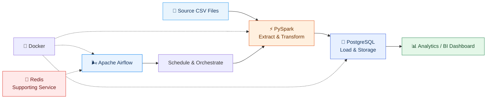

# 🚚 Logistic dan Supply Chain — Data Pipeline ETL

<p align="center">
  
</p>

<p align="center">
  <b>From Raw CSV Files to Structured Data for Supply Chain Analytics</b>
</p>

Proyek ini berfokus pada pembangunan **Automated ETL (Extract, Transform, Load) pipeline** untuk mengolah berbagai file CSV yang berkaitan dengan logistik dan *supply chain*. Pipeline dirancang untuk mengurangi proses pengolahan data secara manual, mengintegrasikan data dari berbagai sumber file, serta menyimpan hasil transformasi ke dalam database PostgreSQL agar lebih mudah diakses untuk kebutuhan analisis dan visualisasi data.

Dengan memanfaatkan PySpark, Apache Airflow, Redis, dan Docker, proyek ini mengeksplorasi penerapan proses ETL yang terstruktur, terjadwal, dan dapat dijalankan dalam lingkungan yang terisolasi.

## 🎯 Project Objectives

Tujuan utama proyek ini adalah membangun alur pengolahan data yang lebih terotomatisasi dan terorganisasi untuk mendukung analisis logistik dan rantai pasok.

- **Automated ETL:** Mengotomatisasi proses pembacaan dan pengolahan beberapa file CSV dari folder sumber.
- **Data Transformation:** Melakukan pembersihan, transformasi, dan penyesuaian struktur data menggunakan PySpark.
- **Data Integration:** Mengintegrasikan data yang relevan dari berbagai sumber menjadi dataset yang lebih terstruktur.
- **Centralized Storage:** Menyimpan hasil transformasi ke PostgreSQL sebagai basis data untuk kebutuhan analisis.
- **Workflow Orchestration:** Mengatur urutan, penjadwalan, dan eksekusi pipeline menggunakan Apache Airflow.
- **Containerized Environment:** Menggunakan Docker untuk mempermudah pengelolaan layanan dan konsistensi lingkungan eksekusi.
- **Supply Chain Analytics:** Menyiapkan data yang telah diproses agar dapat digunakan pada tahap analisis dan visualisasi lebih lanjut.

## 🛠️ Tech Stack

| Technology | Role | Description |
|---|---|---|
|  **PySpark** | Data Processing | Memproses dan mentransformasikan data CSV secara terstruktur dengan Spark DataFrame. |
|  **PostgreSQL** | Database | Menyimpan data hasil ETL agar dapat diakses untuk analisis dan kebutuhan downstream. |
|  **Apache Airflow** | Orchestration | Mengatur dependensi, penjadwalan, dan monitoring task dalam pipeline ETL. |
|  **Redis** | Supporting Service | Menyediakan layanan in-memory yang dapat digunakan untuk kebutuhan caching atau komponen pendukung sesuai konfigurasi. |
|  **Docker** | Containerization | Menjalankan layanan dan dependensi dalam lingkungan container yang terisolasi. |

## 🏗️ Pipeline Architecture



### 🔄 ETL Workflow

#### 1. Extract — Data Ingestion

Pipeline membaca file CSV yang tersedia pada folder sumber. Pendekatan ini memungkinkan beberapa dataset diproses melalui alur yang sama tanpa harus melakukan pengolahan secara manual satu per satu.

#### 2. Transform — Data Processing

PySpark digunakan untuk melakukan transformasi data sesuai kebutuhan, seperti:

- Memeriksa struktur kolom dan tipe data.
- Menangani nilai kosong dan inkonsistensi data.
- Membersihkan atau menyesuaikan format data.
- Menggabungkan dataset yang memiliki relasi.
- Menyiapkan struktur data untuk penyimpanan dan analisis.

Transformasi aktual mengikuti karakteristik dataset dan aturan bisnis yang diterapkan pada pipeline.

#### 3. Load — Data Storage

Data hasil transformasi dimuat ke PostgreSQL agar tersimpan dalam struktur yang lebih terorganisasi dan dapat digunakan kembali tanpa harus mengulangi seluruh proses pengolahan dari file sumber.

#### 4. Orchestration — Automated Execution

Apache Airflow digunakan untuk mendefinisikan dan mengatur alur kerja ETL melalui DAG (*Directed Acyclic Graph*). Dengan orkestrasi ini, proses dapat dikonfigurasi untuk berjalan berdasarkan jadwal serta dipantau melalui antarmuka Airflow.

#### 5. Supporting Services — Redis & Docker

Redis disediakan sebagai layanan pendukung sesuai kebutuhan konfigurasi proyek. Docker digunakan untuk menjalankan komponen pipeline dan dependensinya dalam lingkungan yang konsisten.

#### 6. Analytics — Downstream Usage

Data yang telah tersimpan di PostgreSQL dapat diakses oleh tools analisis atau visualisasi, seperti Power BI dan Tableau, untuk mendukung eksplorasi data dan penyusunan dashboard logistik.

> **Catatan:** Integrasi dashboard merupakan tahap downstream yang dapat dikembangkan setelah pipeline dan struktur data siap. Redis juga tidak dianggap sebagai media penyimpanan utama data warehouse.

<!-- ## 📂 Project Structure

Contoh struktur repositori yang dapat disesuaikan dengan implementasi aktual:

<!-- ```text
ETLogistic/
│
├── data/
│   ├── raw/                 # File CSV sumber
│   └── processed/           # Output hasil transformasi (opsional)
│
├── dags/
│   └── logistic_etl_dag.py  # DAG untuk orkestrasi ETL
│
├── src/
│   ├── extract.py           # Proses pembacaan data
│   ├── transform.py         # Transformasi data menggunakan PySpark
│   └── load.py              # Proses pemuatan ke PostgreSQL
│
├── notebooks/               # Eksplorasi dan pengujian (opsional)
│
├── docker-compose.yml       # Konfigurasi layanan Docker
├── Dockerfile               # Konfigurasi image (jika digunakan)
├── requirements.txt         # Dependensi Python
├── .env            # Template environment variables
├── .gitignore
└── README.md
``` -->

*Struktur di atas merupakan contoh organisasi proyek. Nama folder dan file dapat disesuaikan dengan struktur repositori yang sebenarnya.* -->

## ⚙️ Prerequisites

Pastikan perangkat dan lingkungan pengembangan memiliki kebutuhan berikut:

- [Docker Desktop](https://www.docker.com/products/docker-desktop/) atau Docker Engine.
- [Python](https://www.python.org/) sesuai versi yang kompatibel dengan dependensi proyek.
- [Git](https://git-scm.com/) untuk version control.
- WSL 2 jika menjalankan Docker dan proses ETL melalui lingkungan Linux di Windows.
- File CSV sumber yang tersedia pada direktori yang telah dikonfigurasi.
- Konfigurasi koneksi PostgreSQL serta layanan pendukung yang dibutuhkan oleh Docker Compose.

## 🚀 Getting Started

### 1. Clone Repository

```bash
git clone <repository-url>
cd project-logistic-etl
```

Ganti `<repository-url>` dengan URL repositori GitHub proyek.

### 2. Configure Environment Variables

Jika proyek menggunakan file `.env`, buat file tersebut berdasarkan template yang disediakan.

```bash
cp .env.example .env
```

Sesuaikan konfigurasi koneksi database dan layanan lain dengan lingkungan lokal. Jangan mengunggah kredensial asli ke repositori publik.

### 3. Prepare Source Data

Tempatkan file CSV pada direktori sumber yang sesuai dengan konfigurasi pipeline.

```text
Kode/
└── Dataset/
    └── Ecommerce/
        └── Train
              ├── df_Customers.csv
              ├── df_OrderItems.csv
              ├── df_Orders.csv
              ├── df_Payments.csv
              └── df_Products.csv
```

Nama file di atas hanya ilustrasi. Gunakan dataset aktual yang tersedia pada proyek.

### 4. Start Services with Docker

Jika `docker-compose.yml` telah dikonfigurasi untuk menjalankan seluruh layanan yang diperlukan:

```bash
docker compose up -d --build
```

Periksa status container:

```bash
docker compose ps
```

Periksa log layanan jika terjadi kendala:

```bash
docker compose logs
```

### 5. Run the ETL Pipeline

Setelah seluruh layanan siap, jalankan pipeline melalui DAG Airflow sesuai konfigurasi proyek. Pastikan koneksi database, lokasi file sumber, dan dependensi PySpark telah dikonfigurasi dengan benar.

Jika Airflow menggunakan pemetaan port standar, antarmukanya dapat diakses melalui:

```text
http://localhost:8080
```

Aktifkan atau jalankan DAG ETL sesuai pengaturan yang tersedia pada lingkungan Airflow.

### 6. Verify the Output

Periksa tabel hasil ETL pada PostgreSQL untuk memastikan bahwa data telah berhasil dimuat dan dapat digunakan untuk analisis lebih lanjut.

## 📊 Expected Outcome

Hasil yang ingin dicapai dari proyek ini meliputi:

- Pengolahan beberapa file CSV melalui satu pipeline ETL yang terstruktur.
- Pengurangan pekerjaan manual dalam proses ingestion dan transformasi data.
- Data hasil transformasi yang tersimpan secara terpusat di PostgreSQL.
- Workflow yang dapat dijadwalkan dan dipantau melalui Apache Airflow.
- Lingkungan eksekusi yang lebih konsisten melalui Docker.
- Dataset yang siap dikembangkan untuk kebutuhan analisis dan visualisasi logistik.

## 🔮 Future Improvements

Beberapa pengembangan yang dapat dilakukan selanjutnya:

- **Data Quality Checks:** Menambahkan validasi skema, nilai kosong, duplikasi, dan integritas data.
- **Incremental ETL:** Memproses hanya data baru atau data yang mengalami perubahan.
- **Pipeline Monitoring:** Menambahkan logging, notifikasi kegagalan, dan pemantauan durasi task.
- **Data Modeling:** Mengembangkan skema analitik seperti star schema apabila dibutuhkan untuk pelaporan.
- **BI Integration:** Menghubungkan PostgreSQL dengan Power BI atau Tableau untuk membangun dashboard.
- **Performance Optimization:** Menyesuaikan partisi, ukuran data, dan konfigurasi Spark berdasarkan kebutuhan pemrosesan.